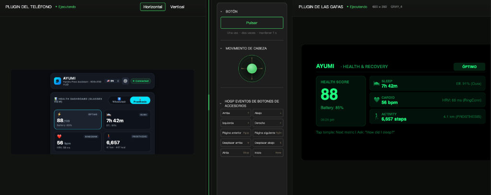
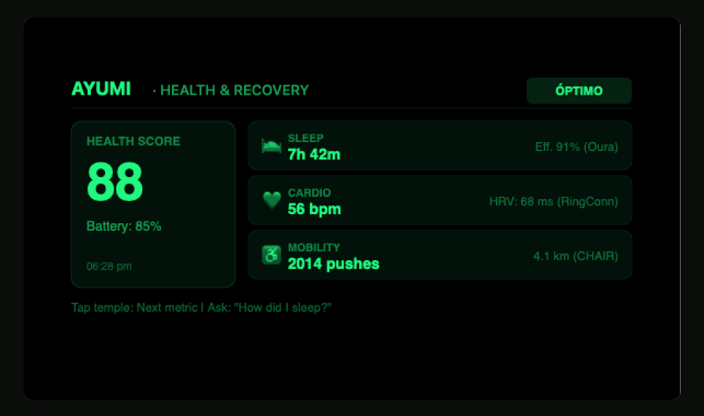
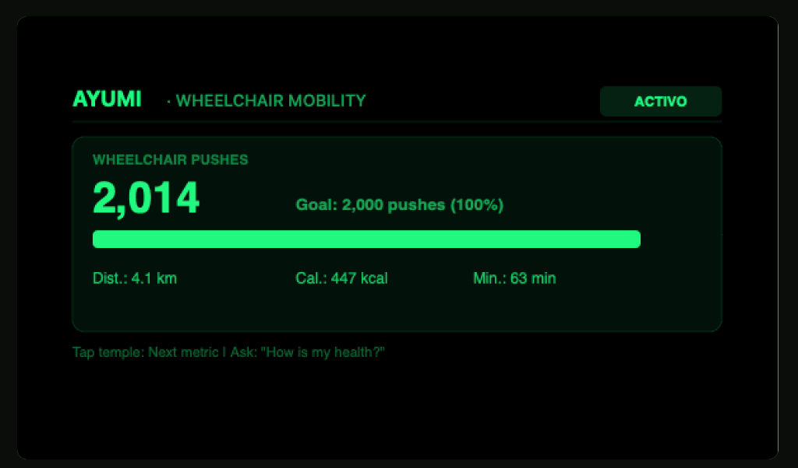
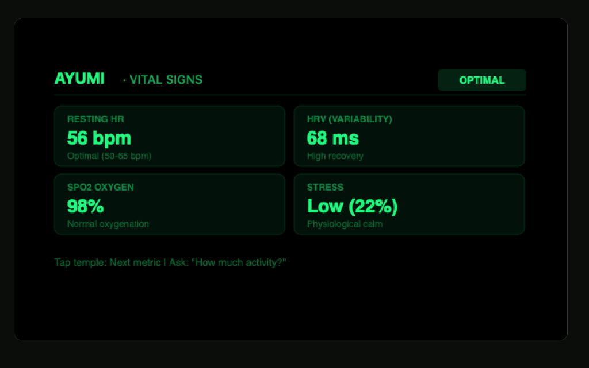
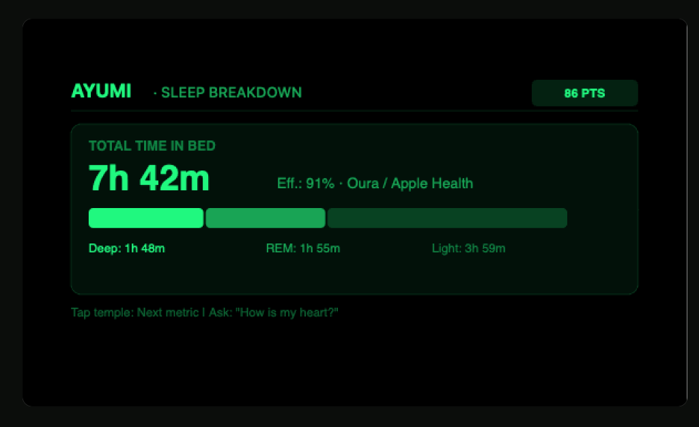
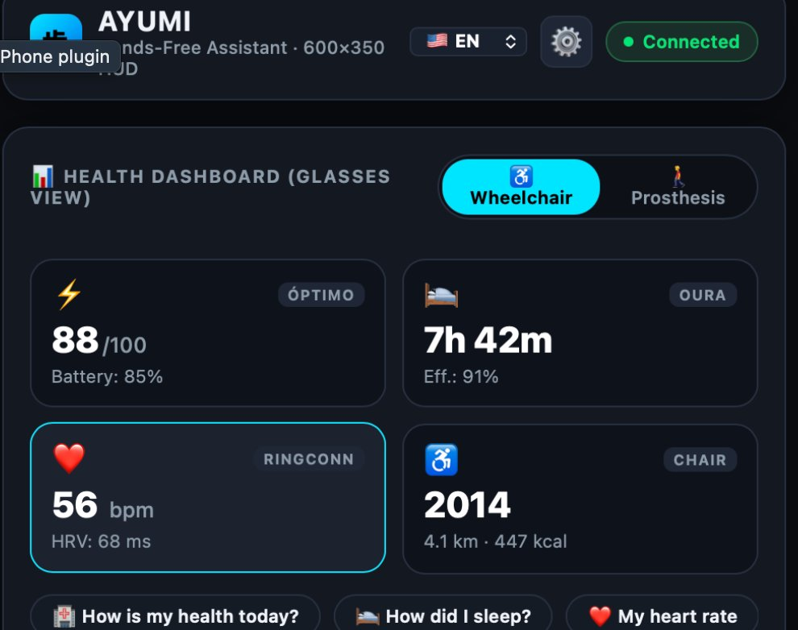
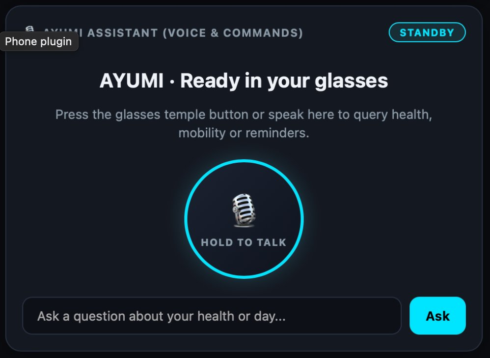

# AYUMI · Asistente de Salud & Movilidad Manos Libres

> **Creado por Nicolás Carvajal**  
> 🦾 Atleta Biónico · Proyecto de Accesibilidad y Autonomía Personal  
> 📸 Instagram / Facebook: **@El.Bioniico** · 🎵 TikTok: **@nosoynico**  
> 👓 Diseñado para gafas inteligentes **MemoMind One** (HUD 600×350)



---

## 🦾 La Historia Detrás de AYUMI: ¿Por Qué Nació Esta App?

> *"Fíjate que me dormí pensando qué hacer real para que fuera funcional en el contexto de que soy una persona amputada y a veces traigo las manos ocupadas con la silla de ruedas o con las muletas. Por eso compré los lentes, para facilitarme la vida. Y dentro de mi pensamiento para facilitarla se me ocurrió esta app: poder leer la salud de Apple, Oura, RingConn, Strava... para que en las mañanas al ponértelas y preguntarle cómo andamos de salud, te devuelva el resumen sin usar las manos."*  
> — **Nicolás Carvajal (@El.Bioniico)**

La mayoría de la tecnología moderna está diseñada asumiendo que el usuario siempre tiene dos manos libres para sostener un teléfono, tocar una pantalla y escribir. 

Para quienes somos personas amputadas, usuarias de silla de ruedas o personas que caminamos con muletas o prótesis, la realidad es muy distinta: **nuestras manos son nuestro medio de transporte, nuestro equilibrio y nuestro apoyo.** Cada vez que nos vemos obligados a detenernos, sacar un celular del bolsillo y mirar hacia abajo, estamos perdiendo estabilidad, tiempo y autonomía.

Compré las gafas inteligentes **MemoMind One** con un propósito muy claro: **recuperar libertad**. Sabía que tener una pantalla óptica flotando en mi campo de visión y micrófonos directos en la patilla podían cambiar mi día a día. Pero faltaba lo más importante: **el software adecuado**.

Las aplicaciones de salud tradicionales ignoran la discapacidad motriz: cuentan "pasos" cuando estás en una silla de ruedas, o no tienen en cuenta el esfuerzo biomecánico de caminar con una prótesis. Por eso creé **AYUMI** (del japonés **歩み**: *el caminar, avanzar paso a paso, progreso*).

---

## 💡 ¿Cómo Esperamos Ayudar a la Gente?

AYUMI no es solo una aplicación; es una declaración de autonomía y tecnología asistiva con propósito:

1. **Autonomía 100% Manos Libres:**
   * Una persona en silla de ruedas o con muletas ya no tiene que soltar las ruedas o los bastones para saber cómo durmió, cómo está su ritmo cardíaco o cuánta energía le queda. Solo levanta la mirada y la información está ahí.

2. **Inclusión Real en la Movilidad (Silla vs. Prótesis):**
   * **Modo Silla de Ruedas:** Mide y registra los **empujes de silla (wheelchair pushes)**, distancia recorrida y calorías quemadas impulsándose.
   * **Modo Prótesis / Pasos:** Para los momentos en que usamos prótesis para caminar, conmuta instantáneamente al conteo de **pasos caminados** y gasto energético.

3. **Prevención y Cuidado de la Salud:**
   * El esfuerzo físico de una persona con amputación o en silla de ruedas es significativamente mayor. AYUMI centraliza la telemetría de anillos como **Oura Ring**, **RingConn** y **Salud de Apple** (sueño profundo, recuperación HRV, frecuencia cardíaca en reposo y SpO2) para evitar fatiga extrema y cuidar el corazón.

4. **Carrusel Automático para Desplazamientos:**
   * Al estar en movimiento, el HUD rota solo cada 8 segundos entre tu resumen de salud, sueño, signos vitales y movilidad. No tienes que tocar ningún botón.

5. **Accesibilidad Internacional (5 Idiomas):**
   * Traducido de forma nativa a **Español, Inglés, Chino (idioma de MemoMind/XGIMI), Francés y Ruso**, llevando esta solución a comunidades con discapacidad alrededor del mundo.

6. **Inspiración para la Comunidad:**
   * Demostrar que las personas con discapacidad no somos únicamente consumidoras de tecnología adaptada, sino que **tenemos la capacidad de programar, diseñar e innovar** soluciones reales que mejoren la vida de miles de personas.

---

## 🌟 Características de la Aplicación

| Módulo | Lo que hace | Beneficio para el usuario |
| :--- | :--- | :--- |
| **Selector de Movilidad** | Alterna con un toque entre `♿ Silla` y `🚶‍♂️ Prótesis`. | Telemetría exacta según si estás rodando o caminando con prótesis. |
| **Morning Health Briefing** | Al ponerte las gafas por la mañana, proyecta tu score de salud (0-100) y batería corporal. | Sabes de inmediato tu nivel de preparación para el día. |
| **Desglose de Sueño** | Gráficas de fases (Profundo, REM, Ligero) y eficiencia (Oura / Apple Health). | Conocer la calidad real del descanso para dosificar la energía física. |
| **Signos Cardíacos & HRV** | Frecuencia cardíaca en reposo, variabilidad HRV (recuperación nerviosa) y SpO2. | Detección de estrés fisiológico o sobreentrenamiento. |
| **Asistente por Voz** | Responde preguntas naturales (*"¿Cómo dormí?"*, *"¿Cómo andamos de salud?"*). | Respuestas concisas en 2 líneas optimizadas para el prisma óptico. |
| **Modo Manos Libres** | Rotación automática en HUD o avance con toque único en la patilla. | Cero dependencia de tocar la pantalla del smartphone. |

---

## 📸 Galería Visual: HUD y Aplicación Móvil

### 👓 Pantallas en el HUD de las Gafas (600×350 Monocromo)

| Salud & Recuperación Diaria | Movilidad en Silla de Ruedas |
| :---: | :---: |
|  |  |
| **Signos Vitales & Cardio** | **Desglose de Fases de Sueño** |
|  |  |

### 📱 Interfaz Companion en el Teléfono

| Panel de Telemetría y Selector de Modo | Asistente de Voz Manos Libres |
| :---: | :---: |
|  |  |

---

## 🏗️ Arquitectura Técnica

```text
┌─────────────────────────────────────────────────────────────────┐
│                    GAFAS (MemoMind One)                         │
│                                                                 │
│  [Botón patilla]            [Micrófonos Frontales]      [HUD]   │
└────────┬─────────────────────────────┬────────────────────▲─────┘
         │ Evento Botón (0x0100)       │ Audio Opus 16kHz   │ LZ4 GRAY_4
         ▼                             ▼                    │ (560x272)
┌───────────────────────────────────────────────────────────┴─────┐
│                    TELÉFONO (AYUMI Core)                        │
│                                                                 │
│  1. Event Dispatcher & State Machine (plugin.js)                │
│     [IDLE / SALUD] ➔ [LISTENING] ➔ [THINKING] ➔ [RESPONSE]      │
│                                                                 │
│  2. Health & Mobility Service (health-service.js)               │
│     - Oura Ring Cloud API / Apple Health / Smart Profile        │
│     - Silla de ruedas (Empujes) vs. Prótesis (Pasos)            │
│                                                                 │
│  3. HUD Rendering Engine (hud-renderer.js)                      │
│     - Canvas 2D ➔ 4-bit Grayscale (GRAY_4) ➔ Compresión LZ4     │
│     - display.updateImageLz4 (Vía GM Web Bridge)                │
│                                                                 │
│  4. Internationalization Engine (i18n.js)                       │
│     - Diccionarios nativos para es, en, zh, fr, ru              │
│                                                                 │
│  5. AI & NLP Provider Layer (ai-provider.js)                    │
│     - AYUMI Local NLP (Consultas semánticas sin nube)           │
│     - Google Gemini 2.0 Flash Multimodal (WAV / Audio directo)  │
└─────────────────────────────────────────────────────────────────┘
```

---

## 📁 Estructura del Repositorio

```text
AYUMI/
├── .gitignore                      # Exclusión estricta de credenciales y binarios
├── README.md                       # Manifiesto, historia y documentación técnica
├── build.js                        # Script oficial de empaquetado .mmpkg
├── docs/
│   └── screenshots/                # Capturas de pantalla en simulador y HUD
└── plugin/
    ├── manifest.json               # Permisos Bridge 2.0 y dependencias
    ├── index.html                  # Interfaz móvil companion y créditos de autor
    ├── style.css                   # Interfaz moderna dark-mode y accesibilidad
    ├── plugin.js                   # Orquestador central de eventos y estados
    ├── i18n.js                     # Motor de traducción (es, en, zh, fr, ru)
    ├── health-service.js           # Agregador de biometría Oura, Apple Health y movilidad
    ├── hud-renderer.js             # Motor de renderizado HUD 600x350 monocromo
    ├── ai-provider.js              # Proveedores de IA y reconocedor de voz
    ├── memory-service.js           # Persistencia de configuración
    ├── recording-lifecycle.js      # Control de captura de audio libre de condiciones de carrera
    └── vendor/                     # SDK oficial Web Bridge 2.0 y decodificador Opus
```

---

## 🔒 Privacidad y Seguridad de Datos

* **Cero claves en el código:** Este repositorio no almacena claves de API, tokens de Oura ni datos privados.
* Las credenciales se ingresan únicamente desde la interfaz de usuario en tiempo de ejecución y se guardan de forma privada en el dispositivo local (`gm.storage` / `localStorage`).

---

## 📦 Compilación del Paquete

Para compilar el plugin distribuible para MemoMind One:

```bash
node build.js
```

Genera el paquete `dist/com.ayumi.app-1.0.0.mmpkg` listo para cargar en **MemoMind Plugin Studio** o instalar en las gafas mediante el **Developer Workbench** de la aplicación móvil.

---

## 💬 Comunidad y Contacto

Si eres una persona amputada, usuaria de prótesis o silla de ruedas, profesional de la salud o desarrollador que quiera colaborar con sugerencias e integraciones:

* 📸 **Instagram:** [@El.Bioniico](https://www.instagram.com/El.Bioniico)
* 📘 **Facebook:** [@El.Bioniico](https://www.facebook.com/El.Bioniico)
* 🎵 **TikTok:** [@nosoynico](https://www.tiktok.com/@nosoynico)

---

## ⚖️ Aviso Legal, Marcas y Salud (Disclaimer)

* **Proyecto Independiente:** AYUMI es un proyecto de código abierto desarrollado de forma independiente por Nicolás Carvajal (@El.Bioniico / @nosoynico) para fines de accesibilidad y autonomía personal.
* **Propiedad de Marcas:** *MemoMind*, *MemoMind One*, *XGIMI*, *Oura*, *RingConn*, *Apple*, *Apple Health*, *HealthKit*, *Google*, *Gemini* y *Strava* son marcas comerciales de sus respectivos propietarios. Su mención en este proyecto responde exclusivamente a fines descriptivos de interoperabilidad y compatibilidad técnica (*nominative fair use*).
* **Aviso Médico:** AYUMI es una herramienta de accesibilidad y consulta informativa. No es un dispositivo médico ni debe emplearse para el diagnóstico o tratamiento de condiciones de salud.
* **Licencia:** Distribuido bajo licencia abierta [MIT](LICENSE) para uso y estudio libre por parte de la comunidad.
